# Avowly

**Pay strangers like you trust them.**

Avowly ties a PayPal payment to a physical thing. When you buy a used phone from someone you met online, PayPal holds your money, you scan the phone in your hands, and the seller gets paid the moment it checks out. If it's the wrong phone, or it's locked, nothing is charged. Rentals work the same way: the deposit comes back by itself unless something on a price list both sides agreed to is missing or broken.

[**Live app: avowly.vercel.app**](https://avowly.vercel.app) · [**Demo video (2:19)**](https://youtu.be/evy2Yd8vFI8) · [**Try a full deal in 2 minutes**](https://avowly.vercel.app/demo) · [Submission](docs/SUBMISSION.md) · [Judge testing guide](docs/JUDGE_TESTING.md) · [How it's built](https://avowly.vercel.app/docs) · [Why PayPal](docs/WHY_PAYPAL.md)

[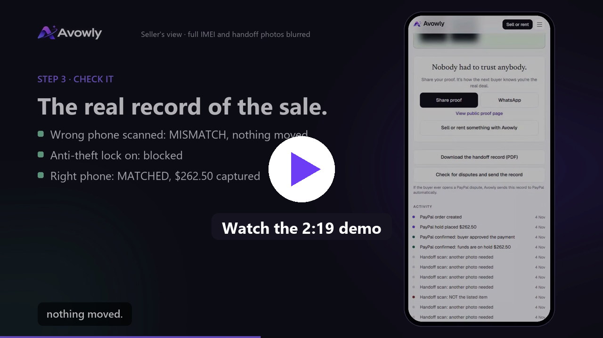](https://youtu.be/evy2Yd8vFI8)

*Watch the 2:19 demo on YouTube. Every screen is the live site on the PayPal sandbox, except one clip of the meetup QR code, which was filmed on a local copy of the same code. How the video was made is in [video/README.md](video/README.md).*

Built by Uzoechi Raphael for the **PayPal AI Hackathon**.

## At a glance

| | |
|---|---|
| **Runs on** | PayPal sandbox, live at [avowly.vercel.app](https://avowly.vercel.app). Deployed on Vercel since October 13, 2026. No real money moves |
| **Real deals on the live site** | A phone sale started by an AI agent, a laptop rental with a missing charger, a PayPal dispute answered with evidence, and the judge demo deal. Each has a public proof page |
| **PayPal used** | JS SDK v6, Orders v2 (authorize), Payments v2 (partial and final capture, void, reauthorize), Payouts, Webhooks with signature checks, Disputes API (provide evidence), Log in with PayPal |
| **AI used** | OpenAI vision with strict structured outputs to read items, compare photos and blur personal details. A Model Context Protocol server for shopping agents |
| **The rule** | The AI only reads. Plain, tested code makes every money decision. The model never sees a price and never touches PayPal |
| **App** | Phone first web app: sell, rent, deal room, proof pages, scam check, help center, docs. Browser notifications and email updates |
| **Tests** | 52 unit tests for every money rule, a script that runs the money paths against the PayPal sandbox, and a live site checker |

## Contents

- [The idea in one minute](#the-idea-in-one-minute)
- [Why Avowly](#why-avowly)
- [Live on the PayPal sandbox](#live-on-the-paypal-sandbox)
- [Product tour](#product-tour)
- [How it works](#how-it-works)
- [Rentals](#rentals)
- [Disputes](#disputes)
- [Shopping agents](#shopping-agents)
- [Privacy](#privacy)
- [Architecture](#architecture)
- [Build log](#build-log)
- [Quickstart](#quickstart)
- [Repository layout](#repository-layout)
- [Documentation](#documentation)
- [Risks and limits](#risks-and-limits)

## The idea in one minute

Every protected payment today trusts a person's word. Someone taps "received" and the money moves. Avowly lets the item decide instead.

1. **Prove it.** The seller photographs the item next to a one-time code Avowly gives them. A photo copied from somewhere else can't have that code. The AI reads the serial number or IMEI from the photos.
2. **Hold it.** The buyer pays with PayPal. The money is authorized, not charged.
3. **Check it.** At the meetup, the buyer scans the code on the seller's phone to confirm it's really them, then scans the item. The serial must match. For phones, the anti-theft lock has to be off.
4. **Release it.** On a match, PayPal captures the payment and the seller gets their full price through Payouts. On anything else, nothing is charged.

## Why Avowly

Buying from a stranger still runs on cash, hope and screenshots.

- A UK bank (TSB) contacted 100 Facebook Marketplace sellers and found **34% of the listings were fraudulent** (2023).
- Reported US fraud losses reached **$12.5B** in 2024, with online shopping the second most reported category (FTC).
- Cash protects nobody. Buyers get swapped or locked phones. Sellers get "the box was empty" claims. Rental deposits get argued from memory.

PayPal already solved trust between strangers online. Nobody had solved it for the moment two people meet in a parking lot. That's the gap Avowly fills.

## Live on the PayPal sandbox

Everything below ran on the live site, with PayPal's own webhooks confirming each step.

| Deal | What happened | Proof |
|---|---|---|
| **Phone sale, started by an AI agent** | An agent found a real Oppo A58 over MCP and started the purchase. A person approved in PayPal ($262.50 held). A different phone's IMEI got Mismatch. The right phone with Find Hub on was blocked. Switch off: Matched. Release captured $262.50 and paid the seller $250 | [/p/jz8gdc2k34f7](https://avowly.vercel.app/p/jz8gdc2k34f7) |
| **PayPal dispute** | The buyer then filed "item not received" (case PP-R-GVB-10196424). Two seconds after PayPal asked the seller to respond, Avowly had sent the handoff record PDF as evidence. PayPal passed the case back to the buyer | Same proof page |
| **Laptop rental** | $20 fee and $100 deposit in one hold. The return scan found the charger missing: $25 kept from the agreed list, $75 released, owner paid $45 | [/p/d6r8tnmjta2m](https://avowly.vercel.app/p/d6r8tnmjta2m) |
| **Judge demo deal** | $126 held, check in with the seller's code, four sample screens through the real AI (Mismatch, One more photo, Locked, Matched), then $120 paid out | [/p/sjaz9ut96z6c](https://avowly.vercel.app/p/sjaz9ut96z6c) |
| **Log in with PayPal** | A seller logged in with PayPal, PayPal reported the account as verified, and the listing now shows "PayPal verified seller" | [/l/95e7cvv333qd](https://avowly.vercel.app/l/95e7cvv333qd) |
| **Email updates** | The test email went out through Gmail and landed in the inbox, not spam | |

## Product tour

**Home.** What Avowly does in one screen, with live numbers from real deals (demo deals don't count).

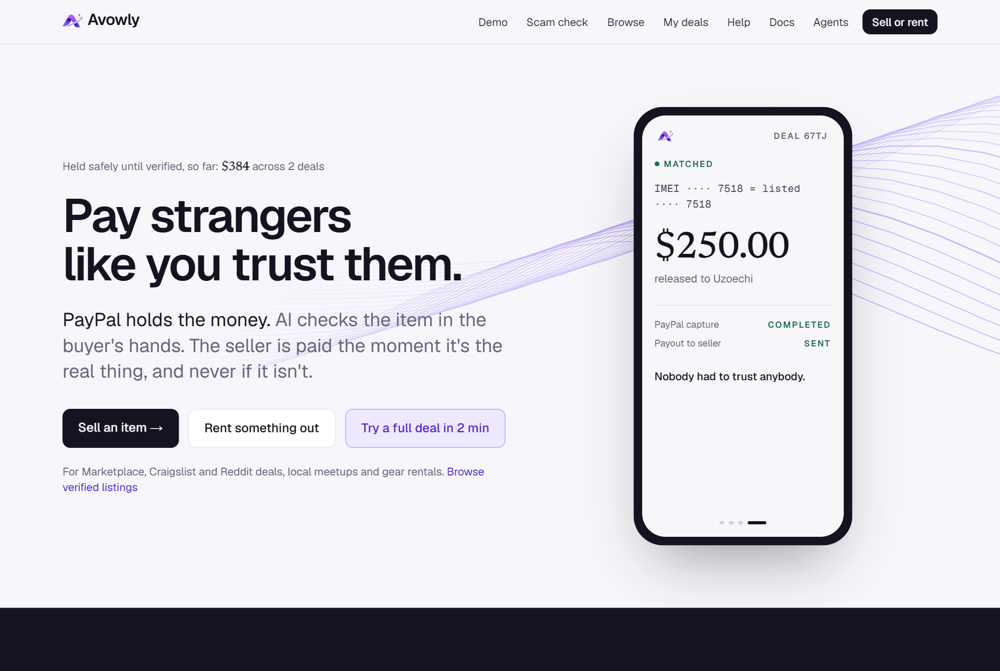

**Try a full deal in 2 minutes.** Built for judges and anyone curious. Avowly lists a sample phone that's already verified, you pay with a PayPal sandbox account, and tap four sample screens that go through the real AI check. Then you release the money and watch the seller get paid.

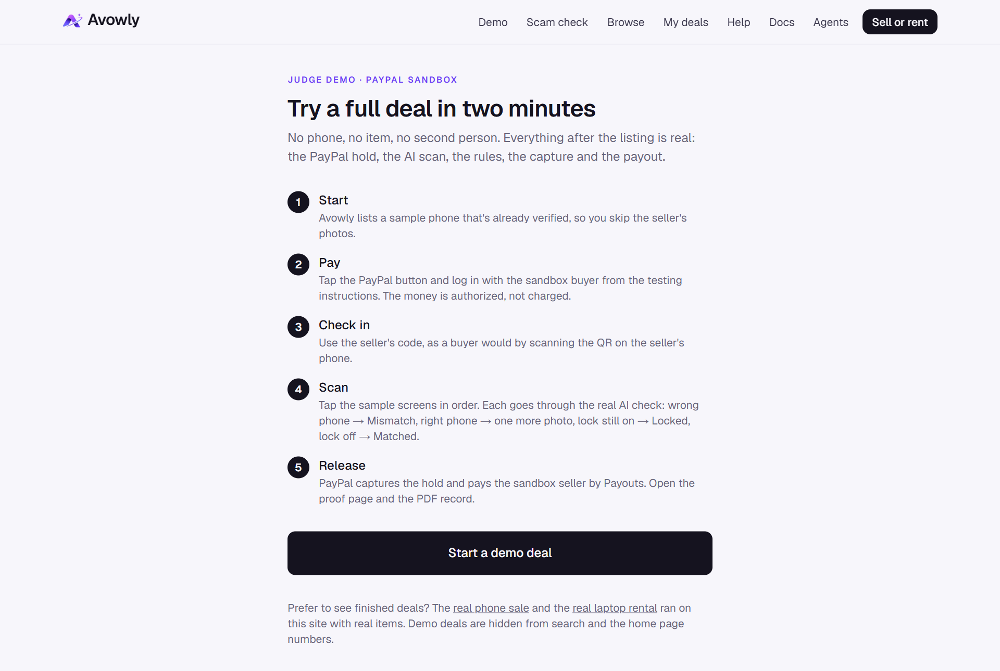

**Listing.** What was verified, the serial on file (only the last four digits are public), a live market price check, and the PayPal button. Sellers who log in with PayPal get the "PayPal verified seller" line.

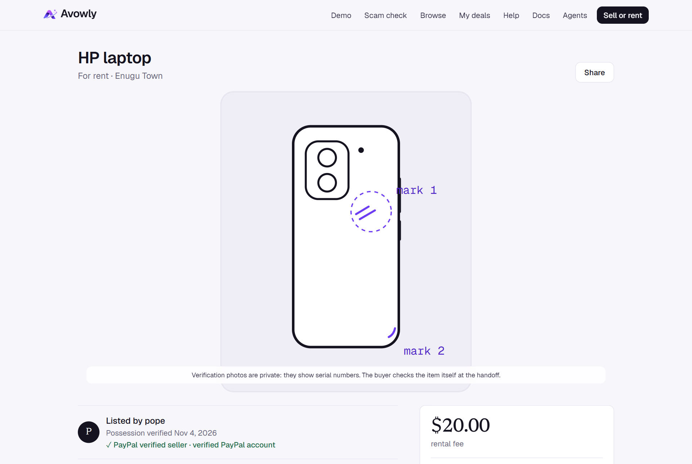

**Deal room.** One number that matters, the latest verdict, the one thing to do next, and a timeline where every PayPal step is confirmed by PayPal's own webhook.

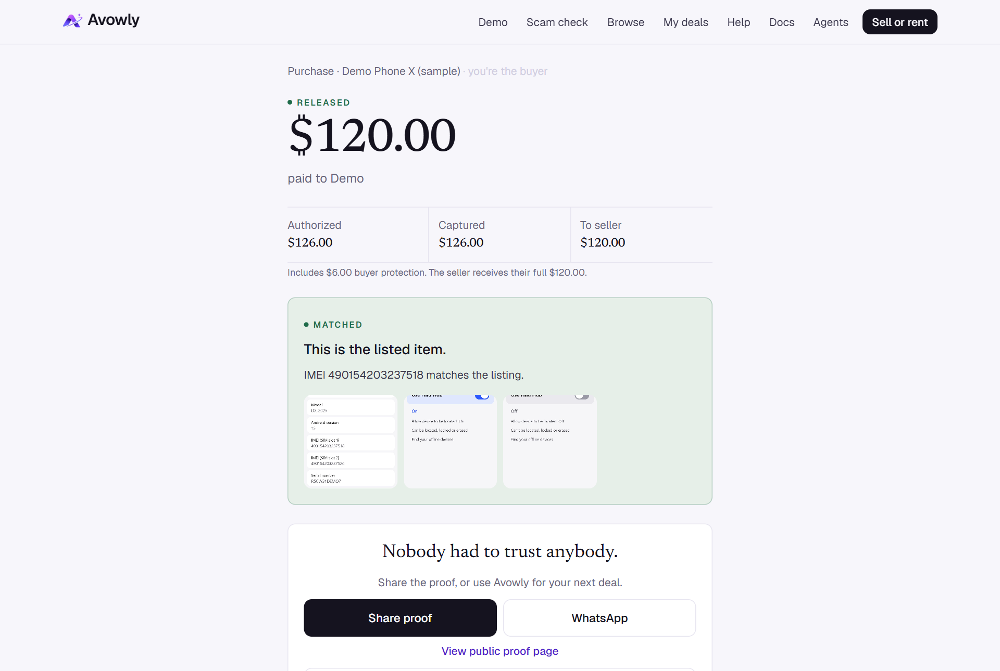

**Proof page.** A public, privacy safe record of a finished deal. If the buyer disputed it, the page shows that Avowly answered with evidence.

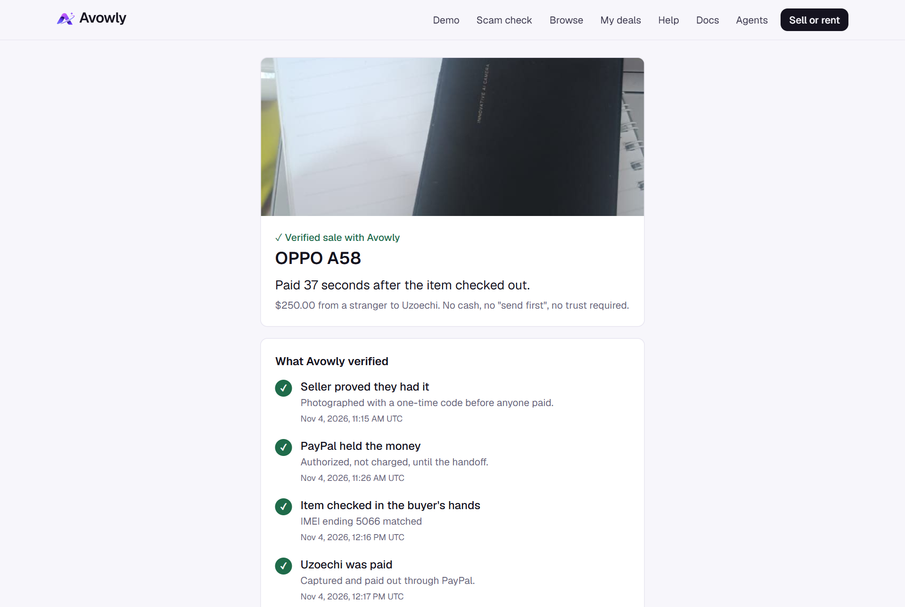

**Free scam check.** Paste any listing from anywhere. You get a verdict, the reasons, and a ready message asking the seller to prove it with Avowly.

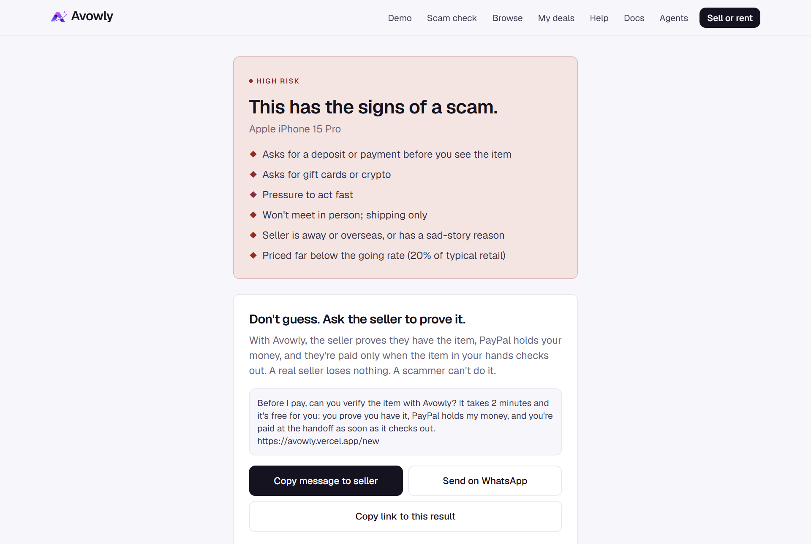

**For agents.** The MCP server and its four tools, with copy and paste setup for any MCP client.

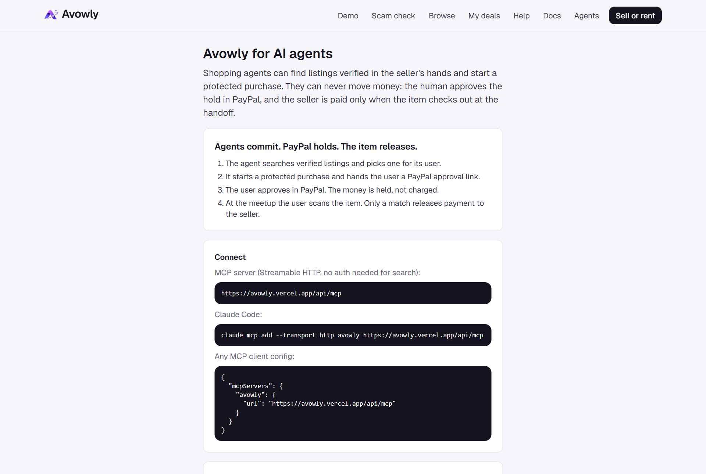

**On a phone,** where it's meant to be used:

<p>
  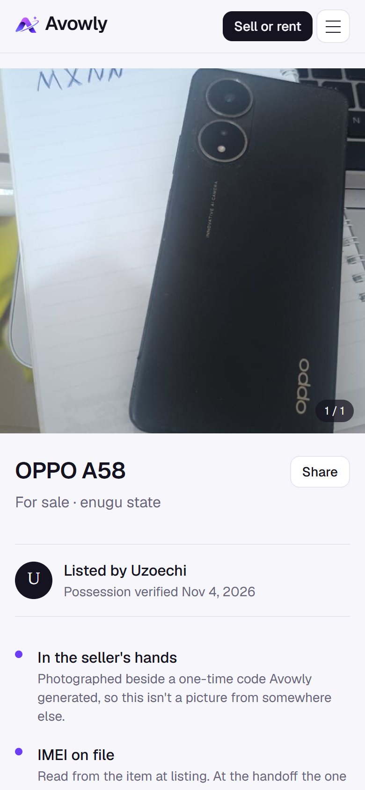
  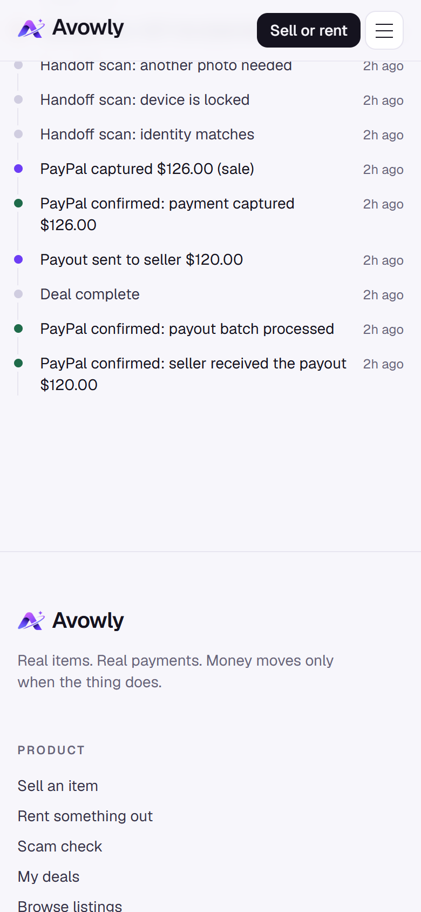
  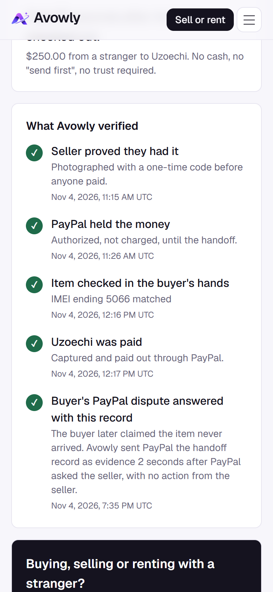
</p>

## How it works

### 1. Possession proof

When a seller lists something, Avowly gives them a random code to write on paper and photograph next to the item. The AI reports the code it sees and every serial or IMEI on the item. Code in [`src/lib/policy.ts`](src/lib/policy.ts) checks the code matches and keeps only identifiers that pass validation (IMEIs must pass the Luhn check). Items with no serial are matched on unique marks recorded at listing.

### 2. The hold

The buyer approves a PayPal order with intent `AUTHORIZE`. Price plus a buyer protection fee is held, not charged. PayPal guarantees a hold for 3 days; Avowly renews it automatically up to day 29.

### 3. Meetup check-in

The seller's deal page shows a QR code and a 6 digit code made from the deal and the seller's private key. When the buyer scans it with their camera, the deal opens and checks them in. It proves they're meeting the person who listed the item, and it goes into the dispute record. Sellers can choose shipping instead: they add the carrier and tracking number, and the buyer scans the item when it arrives.

### 4. The scan

The buyer photographs the item. The AI writes down the identifier it reads **without being told what to expect**, so it can't be led to a match. Code compares it with the listing. Phones and tablets also need a photo of Find My or Find Hub switched off, so nobody pays for a phone that can be locked remotely. Evidence from earlier scans carries over for an hour, so a buyer only adds what's missing.

### 5. Release

On a match, the buyer taps Release. PayPal captures the hold and Avowly pays the seller their full price through Payouts. Every money call carries a `PayPal-Request-Id`, so a retry never charges twice, and a compare and set status change stops double captures.

## Rentals

One hold covers the fee, the protection fee and the deposit. The fee is captured at pickup with `final_capture: false`, after the renter photographs the item and its accessories. At return, the AI compares the item with the pickup photos and lists what changed. Code charges only confident findings that match a price list both sides saw before paying, capped at the deposit. Anything the AI flags that isn't on the list is shown but never charged. A clean return voids the rest of the hold.

## Disputes

Avowly subscribes to PayPal's dispute webhooks. When PayPal asks the seller to respond, Avowly builds a PDF handoff record (possession proof, the match result, photos, the full PayPal timeline) and sends it with the Disputes API `provide-evidence` call. The seller doesn't have to do anything. Tested live on case PP-R-GVB-10196424.

## Shopping agents

An MCP server at `https://avowly.vercel.app/api/mcp` gives agents four tools: `search_verified_listings`, `get_listing`, `start_protected_purchase` and `get_deal_status`. An agent can find an item and start a purchase, but it can never move money. The tool returns a PayPal link only a human can approve, and the item still has to check out at the handoff.

## Privacy

- Before any photo is saved, other people's personal details (phone numbers, names, call logs, faces) are pixelated. The original is never stored, EXIF data is removed, and if the check fails nothing is saved at all.
- Photos are private by default. Only clean shots of the item can appear publicly.
- Proof pages never show keys, emails or full serial numbers.
- Scam check text isn't stored. IP addresses are stored only as salted hashes.
- Emails sent are recorded as sent or not sent, never with the address.

## Architecture

| Layer | What | Code |
|---|---|---|
| Web app | Next.js and TypeScript on Vercel, Tailwind | `src/app`, `src/components` |
| Money rules | Every capture, charge and release decision, unit tested | `src/lib/policy.ts` |
| PayPal | Orders, payments, payouts, webhooks, disputes, Log in with PayPal | `src/lib/paypal.ts`, `src/lib/paypalIdentity.ts`, `src/app/api/webhooks/paypal` |
| AI | OpenAI Responses API with vision and strict schemas | `src/lib/vision.ts`, `src/lib/redact.ts`, `src/lib/scamcheck.ts` |
| Market prices | Channel3, matched only on the same brand and model number | `src/lib/channel3.ts`, `src/lib/market.ts` |
| Agents | MCP server | `src/app/api/mcp/route.ts` |
| Data | Postgres on Neon, Drizzle migrations. Without a database URL it runs an embedded Postgres locally | `src/lib/db`, `drizzle/` |
| Updates | Web push and email (Gmail or Resend) | `src/lib/notify.ts` |

## Build log

| Date | Milestone |
|---|---|
| 2026-10-12 | First version: PayPal holds released by an AI item check at the handoff |
| 2026-10-13 | Buyer protection fee and seller payouts, dispute evidence, proof pages, push and email, market price check, the MCP server for agents, a new design. Live on Vercel |
| 2026-10-15 | Personal details blurred in every photo before it's stored; help center, FAQ, docs, trust and safety pages |
| 2026-11-04 | Scam check, live badge, My deals. Renamed to Avowly. **Live sale started by an AI agent**, then a **live rental** and a **live PayPal dispute** answered with evidence |
| 2026-11-05 | Email updates tested in a real inbox. **Judge demo mode, meetup QR check-in, shipped sales and Log in with PayPal**, each run on the live site. Final demo video |

## Quickstart

You need Node 20 or newer, a PayPal sandbox app and an OpenAI key.

```bash
git clone https://github.com/angelraph/avowly
cd avowly
npm install
cp .env.example .env.local   # add your PayPal sandbox and OpenAI keys
npm run dev
```

Open http://localhost:3000. You don't need a database: without `DATABASE_URL`, Avowly uses an embedded Postgres in `./.data`. Sandbox account setup is in [SETUP.md](SETUP.md).

```bash
npm test               # money rules, check-in codes, scam scoring, data cleaning
npm run test:paypal    # runs the money paths against your PayPal sandbox
```

## Repository layout

```
src/app/              pages (home, sell, listing, deal room, proof, demo, scam check, docs) and API routes
src/app/api/          deals, listings, demo, paypal login, webhooks, MCP server, notifications
src/lib/              money rules, PayPal client, AI reading, redaction, disputes, evidence PDF, notifications
src/components/       PayPal button, photo picker, notifications, email updates, landing page parts
drizzle/              database migrations
public/demo/          sample phone screens for the judge demo (documentation IMEIs, not real phones)
scripts/              PayPal sandbox mechanics test, live site checker, read only diagnostics
docs/                 submission text, judge testing guide, why PayPal, video script and transcript
media/                screenshots used in this README
video/                how the demo video was made
```

## Documentation

| Document | What's in it |
|---|---|
| [docs/SUBMISSION.md](docs/SUBMISSION.md) | The hackathon submission text |
| [docs/JUDGE_TESTING.md](docs/JUDGE_TESTING.md) | How to test everything, starting with the 2 minute demo deal |
| [docs/WHY_PAYPAL.md](docs/WHY_PAYPAL.md) | Why this belongs inside PayPal, and what it could become |
| [SETUP.md](SETUP.md) | PayPal sandbox accounts, keys and webhooks |
| [docs/VIDEO_SCRIPT.md](docs/VIDEO_SCRIPT.md) | The demo video scene by scene |
| [docs/VIDEO_TRANSCRIPT.txt](docs/VIDEO_TRANSCRIPT.txt) | The full narration with timestamps |
| [video/README.md](video/README.md) | How the demo video was recorded and put together |
| [/docs on the site](https://avowly.vercel.app/docs) | Architecture, PayPal flows, the AI and rules split, API |

## Risks and limits

- **Sandbox only.** Paying sellers directly from a hold needs PayPal partner approval, so Avowly holds through its own account and pays sellers with Payouts.
- **The AI reads, it doesn't inspect.** A matching serial proves it's the listed item, not that every part works. Low confidence reads ask for another photo and are never charged.
- **Lock status comes from the phone's own screen.** Carrier blacklist checks aren't included yet.
- **Blurring isn't perfect.** It relies on the model finding personal details, so small or decorative text can be missed. In testing, a name in decorative script on a notebook stayed readable in one photo. Photos that show anything personal stay private to the two people in the deal.
- **Browser notifications** depend on the phone. Google accepted every push we sent, but our Android test phone blocked them, so email updates cover the same events.
- Nothing here is financial advice.

## License

[MIT](LICENSE) · Built by Uzoechi Raphael · [avowly.vercel.app](https://avowly.vercel.app)
